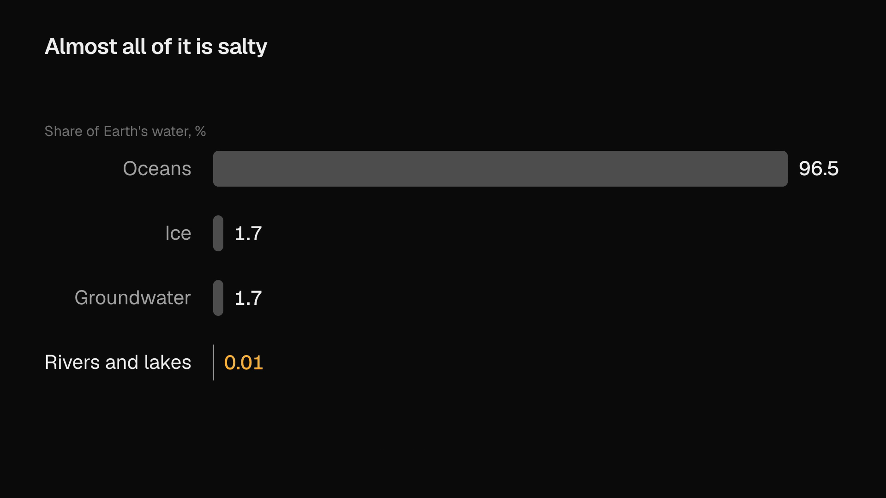
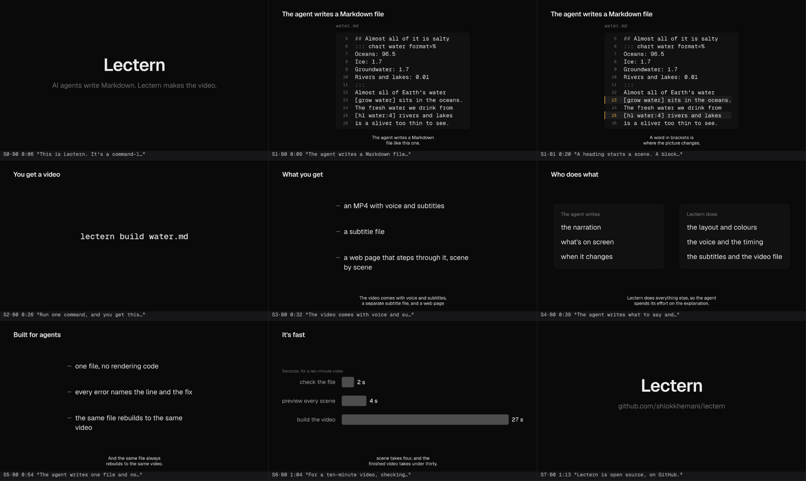

# lectern

**One Markdown file in. A narrated explainer video out.**

An agent writes a single Markdown file: what to say, what to show, and on which word things change. Lectern turns
that file into a finished video, with voice, layout, theme, motion, subtitles and encoding. The agent never writes
rendering code, positions anything or picks a colour, so every token it spends goes into the explanation.

https://github.com/user-attachments/assets/4ec85aac-f776-487a-bee6-d3c482b04fe5

[Watch the 85-second video with sound](docs/media/lectern.mp4). It was made with Lectern, from
[`examples/lectern.md`](examples/lectern.md); the screen that plays `water.md`'s video is placed by
[`examples/lectern/compose.ts`](examples/lectern/compose.ts).

## The Markdown file

It reads like a document, because it is one. Headings are scenes, `:::` fences are what's on screen, paragraphs
are the narration, and `[cues]` sit on the words where the picture changes. This is a complete video:

````md
---
title: Where Earth's water is
---

## Almost all of it is salty

::: chart water format=%
Oceans: 96.5
Ice: 1.7
Groundwater: 1.7
Rivers and lakes: 0.01
:::

Almost all of Earth's water [grow water] sits in the oceans. The fresh water we drink from [hl water:4] rivers
and lakes is a sliver too thin to see.
````

The voice reads the paragraph. As it says "sits", the bars grow in; as it says "rivers", the last bar lights up:



Nothing in the file says where the chart goes, how big it is, what colour the highlight is, or how long anything
takes. Lectern decides all of that, the same way every time.

On screen you can put code (from your real source files, with line ranges), trees, graphs, charts, tables,
token strips, equations, side-by-side comparisons and custom SVG, and things can move: a point along a chart
line, an item along a path. `skill/reference.md` is the whole language, in 220 lines.

From one Markdown file you get:

- an **MP4** with voice and burned-in subtitles,
- an **`.srt`**,
- a **step-through HTML page** to go beat by beat,
- **contact sheets**, one tile per beat, for review (by you or by the agent).

The contact sheet of the video above, one tile per beat:



## Quick start

Needs [Bun](https://bun.sh), `ffmpeg` on the PATH, and two API keys in `.env` at the repo root:

```sh
GEMINI_API_KEY=...       # the voice (Gemini TTS)
OPENROUTER_API_KEY=...   # checks every take by transcribing it
```

```sh
bun install && bun link                 # puts `lectern` on your PATH
lectern check examples/water.md        # parse, lay out and lint every frame (about a second)
lectern shots examples/water.md        # + contact sheets to look at
lectern build examples/water.md        # MP4, .srt, HTML, sheets in ./out/<slug>/
```

The first run downloads a pinned headless Chrome (~215 MB), so every machine renders the same pixels. `check`
starts voicing in the background, so the build that follows takes seconds. Voice costs roughly $0.10–0.20 per
video.

## For agents

`skill/` is a Claude Code skill: `SKILL.md` is the workflow (outline, verify, write, check, look, build) and
`reference.md` the language. Link it into `~/.claude/skills/lectern` and point the CLI path in `SKILL.md` at your
clone. Then ask your agent for a video.

When something is wrong, Lectern says where and how to fix it, in a form the agent can paste:

```
lesson.md:41 S3·B2 "ops": error L410: "ops" (640px) and "rule" (560px) need 1248px side by side; the row has 1152px
  fix: put one of them @top, or remove @left
```

## How it works

```
lesson.md → parse → timing plan ← voice (TTS, checked by speech-to-text, cached)
                         ↓
       one HTML stage: every frame is a pure function of the plan
                         ↓
       lint every frame → capture in headless Chrome → ffmpeg → MP4 + .srt + HTML + sheets
```

- **The engine owns the look.** Blocks size to their content; lint fails a frame that overflows or collides,
  with exact widths. One theme, in `theme/v2/tokens.css`.
- **Deterministic.** The same file and voice give the same video, byte for byte.
- **Fast to iterate.** For a 10-minute video: `check` about 2 s, contact sheets about 4 s, a cold build about
  27 s, and an edit rebuilds only the scene it touched.

## Repo map

| Path | What |
|---|---|
| `src/script/` | the language: parser, selectors, cues, diagnostics |
| `src/timing/` | every clock: spans, eases, the frame plan, subtitles |
| `src/blocks/` | block types (`core/`, `cs/`), each a small module |
| `src/runtime/` | the page: layout, settle, lint |
| `src/audio/` | TTS, transcription check, voice cache, voice-ahead |
| `src/render/` | Chrome pool, capture, encode, render cache, build lock |
| `skill/` | what authoring agents read |
| `examples/` | `water.md` (the 10-second example above), `lectern.md` (the demo video) |
| `docs/` | `spec-v1.md`, `rulings.md` (product decisions), `design-principles.md` |
| `test/` | end-to-end tests |

Working on the engine itself? Start with `AGENTS.md`.

## Tests

```sh
bun run check    # typecheck + e2e suite, ~80 s, offline
```

Every test runs the real CLI on a Markdown file and checks only what an agent or viewer sees: the printed
diagnostics, `build.json`, frames from the MP4, the `.srt`, the sheets. Saved voice in `test/fixtures/voice/` keeps
it offline; `LECTERN_LIVE=1 bun test` adds one live run. `docs/test-coverage.md` maps what's covered.

## Status

Early. Good enough for real videos; expect the language to change.

## License

MIT. The example code in `examples/part8/src/` is from *Writing An Interpreter In Go* (Thorsten Ball), also MIT.
